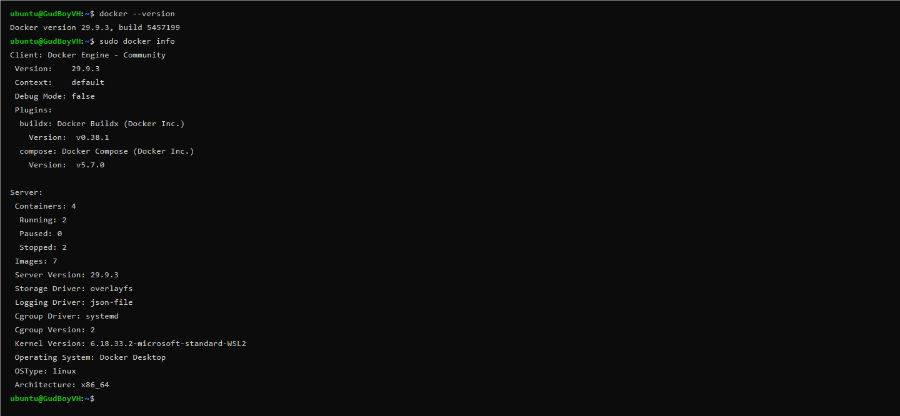
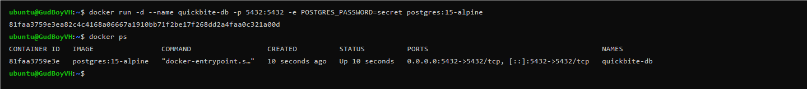
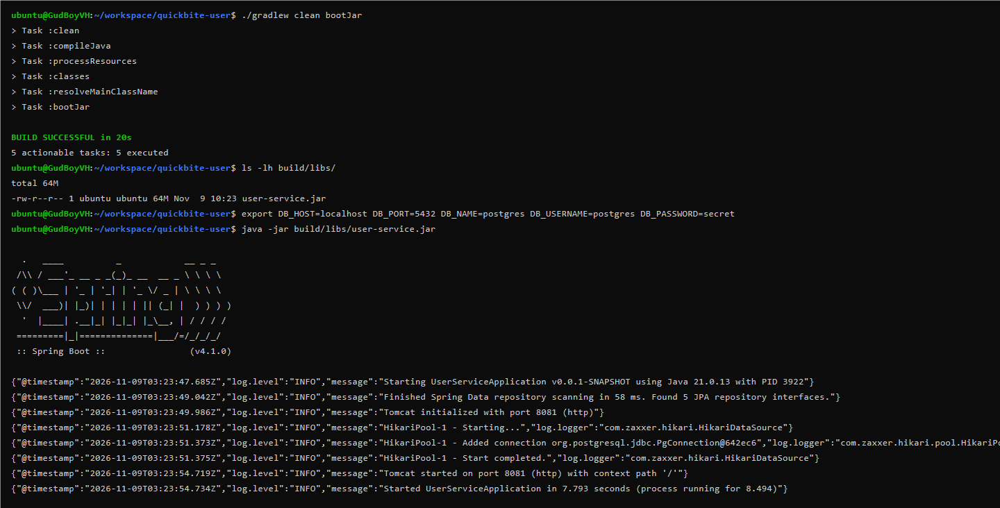

# Báo Cáo Thực Hành Tổng Hợp - Session 02
**Hệ thống:** QuickBite Food Delivery Platform (`user-service` & `quickbite-db`)

---

## Nhiệm vụ 1: Cài đặt và Xác thực Docker Engine

### 1. Các câu lệnh đã sử dụng
```bash
# Cập nhật danh sách gói hệ thống Ubuntu Linux
sudo apt-get update

# Cài đặt Docker Engine từ repository của Ubuntu
sudo apt-get install docker.io -y

# Kiểm tra phiên bản Docker đã cài đặt
docker --version

# Kiểm tra thông tin chi tiết của Docker Engine
sudo docker info
```

### 2. Ảnh chụp màn hình kết quả (Ảnh 1)


---

## Nhiệm vụ 2: Khởi chạy Cơ sở dữ liệu PostgreSQL bằng Docker

### 1. Các câu lệnh đã sử dụng
```bash
# (Tùy chọn) Xóa container quickbite-db cũ nếu đang tồn tại
docker rm -f quickbite-db

# Khởi chạy container PostgreSQL 15-alpine chạy ngầm (-d), cổng 5432:5432, mật khẩu secret
docker run -d --name quickbite-db -p 5432:5432 -e POSTGRES_PASSWORD=secret postgres:15-alpine

# Kiểm tra trạng thái container đang hoạt động (Up)
docker ps
```

### 2. Ảnh chụp màn hình kết quả (Ảnh 2)


---

## Nhiệm vụ 3: Tải Mã nguồn và Biên dịch Ứng dụng (`quickbite-user`)

### 1. Các câu lệnh đã sử dụng
```bash
# Tạo thư mục làm việc ~/workspace và di chuyển vào đó
mkdir -p ~/workspace
cd ~/workspace

# Kéo mã nguồn dự án từ GitHub
git clone https://github.com/backend-fullskill-devops/quickbite-user
cd quickbite-user

# Cấp quyền thực thi cho Gradle Wrapper và biên dịch ra file .jar
chmod +x gradlew
./gradlew clean bootJar

# Xác nhận file user-service.jar đã được sinh ra trong build/libs/
ls -lh build/libs/
```

---

## Nhiệm vụ 4: Khởi chạy và Kết nối Ứng dụng với PostgreSQL Container

### 1. Các câu lệnh đã sử dụng
```bash
# Thiết lập các biến môi trường kết nối tới container quickbite-db (jdbc:postgresql://localhost:5432/postgres)
export DB_HOST=localhost
export DB_PORT=5432
export DB_NAME=postgres
export DB_USERNAME=postgres
export DB_PASSWORD=secret

# Khởi chạy ứng dụng từ file JAR đã biên dịch
java -jar build/libs/user-service.jar
```

### 2. Ảnh chụp màn hình kết quả Build JAR & Khởi chạy kết nối HikariCP (Ảnh 3)

